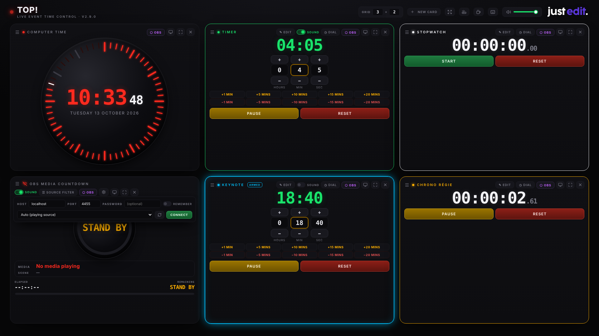

# TOP! — 现场活动时间控制

**单个 HTML 文件。无需安装。无需服务器。无需联网。**

Develop by just edit; Translate by wibi8bo.

原项目地址：[https://github.com/noar-justedit/top](https://github.com/noar-justedit/top)

时钟、秒表、倒计时器和 OBS 媒体倒计时，专为现场活动制作而设计 —— 面向舞台监督、活动导演和广播操作员。



**立即使用：** [noar-justedit.github.io/top](https://noar-justedit.github.io/top/)

---

## 功能

- **参考时钟** —— Gorgy Timing 风格的圆形表盘，60 段秒环，日期显示
- **倒计时器** —— 想要多少个独立的倒计时就有多少个。每个都有自己的名称、颜色、时长、预设、声音开关和超时正计时。运行中可实时调整，进度环按颜色编码（绿 → 琥珀 → 红 → 闪烁）
- **秒表** —— 想要多少个就有多少个，各自拥有名称和颜色。开始/暂停/重置，数字视图和 Gorgy 表盘视图
- **OBS 媒体倒计时** —— 通过 WebSocket v5 连接 OBS Studio，为当前播放的媒体源倒计时（Media Source、VLC 播放列表、播放列表插件）。自动识别播出中的源，忽略循环背景，支持按场景勾选的源过滤器以及音频/视频类型开关。连接设置会被记住并自动重连。待机时显示 "STAND BY"，下方显示当前场景名称 —— 仅显示名称，大小随表盘适配，必要时缩短，绝不会跑到圆环下方
- **声音提示** —— 在 5 分钟、2 分钟、1 分钟、30 秒、20 秒时进行语音播报，然后是 10 → 1 秒倒数，倒计时器和 OBS 媒体倒计时均支持。顶栏有总音量滑块
- **可增删的卡片** —— `+ NEW CARD` 可添加倒计时器、秒表或 OBS 媒体倒计时；每张卡片都有关闭按钮和最大化按钮。在顶栏输入想要的网格形状（`3 × 2`、`4 × 1`……），各行均分屏幕高度。任意两张卡片之间可拖拽交换位置。一切都在两次会话之间被记住
- **吸附布局** —— 把卡片拖到窗口顶部并选择一种布局，就像在 Windows 里一样：一张高卡片旁边叠两张、两张在上一张宽的在下、四分之一–半–四分之一分割……卡片绝不会留下空格：它会伸展占据空格
- **OBS 集成** —— 每个工具都有透明背景的 Browser Source URL
- **Stream Deck / Bitfocus Companion** —— 通过键盘快捷键实现完全控制，无需插件
- **第二屏** —— 屏幕投影按钮可将整个网格放到另一台显示器上，并移除所有控件；每张卡片上的按钮可将该卡片单独全尺寸发送。两者都与控制窗口保持同步
- **屏幕保持常亮** —— **保持常亮**（顶栏的杯子图标）请求系统在 TOP! 显示期间不要调暗或休眠屏幕
- **完全离线** —— 所有资源均已内嵌，时钟 / 秒表 / 倒计时器在没有网络连接时也能工作

---

## 使用方法

1. 下载 [`index.html`](https://github.com/noar-justedit/top/blob/main/index.html)
2. 用任何现代浏览器打开（Chrome、Firefox、Safari、Brave……）
3. 就是这样。

或者直接访问 [noar-justedit.github.io/top](https://noar-justedit.github.io/top/) 使用 —— 在 iPhone/iPad 上，用 Safari 打开并点击 **分享 → 添加到主屏幕**，即可获得类似原生应用的体验。连续点按控件两次不会再缩放页面；双指捏合缩放仍然可用。

---

## 键盘快捷键

| 按键 | 作用 |
|---|---|
| `空格` | 选中的倒计时器 开始 / 暂停 |
| `R` | 选中的倒计时器 重置 |
| `Tab` / `Shift`+`Tab` | 选择下一个 / 上一个倒计时器 |
| `←` `→` | 在 时 / 分 / 秒 之间移动 |
| `↑` `↓` 或 `+` `−` | 增减当前单位 |
| `C` | 秒表 开始 / 暂停 |
| `X` | 秒表 重置 |
| `F1` | 最大化时钟 |
| `F2` | 最大化第一个倒计时器 |
| `F3` | 最大化第一个秒表 |
| `F4` | 最大化 OBS 媒体卡片 |
| `Esc` | 关闭打开的对话框，否则退出全屏，否则返回网格 |

每个操作都映射到一个按键 —— 这意味着开箱即可实现完全的 **Stream Deck** 或 **Bitfocus Companion** 控制。完整列表在顶栏的 **`⌨ SHORTCUTS`** 对话框中。

按住屏幕上的 `+` 或 `−` 按钮可以让数值持续增减；按得越久速度越快。

---

## 顶栏

从左到右，按你使用的顺序排列：**GRID（网格）**、**`+ NEW CARD`**，然后是全屏、屏幕投影、保持常亮和键盘快捷键图标，最后是总音量。

将鼠标悬停在任何控件上，它就会说明其作用 —— 对于图标，还会说明其所处状态：屏幕保持是否真正被授予、投影窗口是否已打开、为什么 `+ NEW CARD` 拒绝在 3 × 2 网格中添加第七张卡片。

---

## 卡片

TOP! 打开时是一个 2 × 2 网格：**时钟**、**倒计时器**、**秒表** 和 **OBS 媒体倒计时**。

点击顶栏的 **`+ NEW CARD`** 即可添加 —— 一个倒计时器、一个秒表，或者你之前关闭的 OBS 媒体倒计时。一次选择一种类型。倒计时器和秒表随后会要求输入名称和颜色。

每张卡片带有三个按钮：**⬡ OBS** 用于获取其 Browser Source URL，**最大化** 让它占满整个页面，**关闭**（带确认）。你关闭的任何卡片都可以从 `+ NEW CARD` 中找回 —— 包括时钟，它只在网格上没有时钟时才会出现。

网格恰好容纳 `列 × 行` 张卡片，所以在 2 × 2 网格中添加第五张卡片意味着要先扩大网格。

## 第二屏

顶栏的 **屏幕投影** 会打开一个携带整个网格的第二个窗口：相同的卡片、相同的位置、相同的形状 —— 但移除了你按下的一切。没有卡片按钮、没有 START / PAUSE / RESET、没有 `+` `−`、没有预设、没有声音开关、没有 OBS 设置、没有拖拽手柄、没有分隔条。只有卡片名称、颜色和数字。

因为控件不再占地方，数字就占据了这些空间：每张卡片测量剩余空间并据此调整显示大小。每张卡片还会保留 **你在控制窗口中选择的视图** —— 数字或 Gorgy 表盘，逐卡片保留，如果你在演出中途切换其中一个，第二屏会实时跟随。改变网格形状、添加卡片、关闭卡片、给计时器改名或换颜色：第二屏都会同步反映。

**卡片上的屏幕按钮** 则完成另一项工作 —— 将该卡片单独放到另一台显示器上，大数字、名称和颜色。这是演讲者或观众观看的内容。两种模式可以同时运行在两台不同的显示器上。

**它们如何保持同步。** 在窗口之间传递的不是数字，而是截止时间，以机器自身的时钟为准 —— 第二个窗口自己计数，每秒自我校正八次，因此延迟或丢失的消息不会改变屏幕上的任何内容。实测一致性：10 毫秒以内，包括 4K 显示器。

**放置窗口。** 在 Chrome 和 Edge 上，TOP! 可以向系统询问你的显示器位置，并直接将窗口打开到第二台显示器上 —— 浏览器第一次会请求权限。Safari 和 Firefox 没有这样的 API：窗口正常打开，你把它拖到另一台显示器上，然后双击进入全屏。下次浏览器会在同一位置重新打开它。

第二屏会自行保持常亮。如果它失去与控制窗口的联系，它会变暗，而不是停留在一个不再准确的数字上；关闭控制窗口时，其屏幕也会随之关闭。

屏幕也是一个普通的 URL，所以你可以收藏它或手动重新打开，它会自动重新连接：

| 内容 | URL |
|---|---|
| 整个网格 | `?screen=1` |
| 时钟 | `?tool=clock&screen=1` |
| 倒计时器 | `?tool=timer&screen=1&cid=…` |
| 秒表 | `?tool=chrono&screen=1&cid=…` |
| OBS 媒体倒计时 | `?tool=media&screen=1` |

> 这只在同一台机器上同一浏览器的窗口之间有效。它无法到达 OBS Browser Source，因为那是一个独立的浏览器 —— 那些是彼此独立的实例。

---

## 多个倒计时器和秒表

给一个计时器起个名字、选个颜色、设定初始时长 —— 一张带有自己倒计时的新卡片就出现了。秒表的工作方式相同。

倒计时器和秒表完全独立：开始、暂停、调整或重置其中一个绝不会影响另一个。每张计时器卡片都有自己的预设、自己的 SOUND 开关和自己的超时正计时。

新计时器与其他卡片添加到同一个网格中，并排显示。**按住卡片标题将其拖到另一张卡片上即可交换它们的位置** —— 顺序会被记住。

**颜色标识计时器** —— 它勾勒出卡片轮廓并标记圆点和名称，无论计时器是否被选中都会保持。倒计时本身保持 绿 → 琥珀 → 红 的状态编码，所以任何计时器的紧急程度在所有卡片上的读法都一致。

**键盘快捷键跟随选中的计时器。** 点击一张卡片将其选中：它会以自己颜色的光晕点亮并显示 `ARMED` 徽章，`空格`、`R` 和方向键都作用于它。`Tab` 在计时器之间循环。只有一个计时器时没有任何变化 —— 它默认被选中。

使用计时器或秒表卡片上的 **`✎ EDIT`** 来重命名和换颜色 —— 对于计时器，还可以改变时长。名称、颜色、时长和开关都会在两次会话之间被记住。

## 保持屏幕常亮

**保持常亮**（顶栏的杯子图标）请求操作系统在 TOP! 显示期间不要调暗屏幕或让显示器休眠。它默认开启，且选择会被记住。

它使用浏览器自带的 Screen Wake Lock —— 无需权限对话框，无需扩展。当标签页进入后台时锁会被释放，回到前台时重新获取。Chrome、Edge、Brave、Firefox 和 Safari 16.4 及更高版本（包括 iPad 和 iPhone）都支持；在较旧的浏览器上该按钮会变灰。

> 它保持的是*屏幕*常亮，而不是机器：合上笔记本盖子仍然会使其休眠，公司政策强制的屏保仍然优先。

---

> 新计时器上的语音提示默认关闭。多个计时器同时播报会互相盖过对方，所以只给应该发声的那个计时器打开 SOUND。

---

## 布局

在顶栏设置网格的形状：**`GRID  3 × 2`** 表示三列两行。

**竖屏和横屏各自记住自己的形状。** 旋转平板电脑，你为那个方向设置的布局就会回来。第一次使用某个方向时，TOP! 会选择一个合理的形状 —— 平板竖握时两列，手机上一列 —— 然后你再自行更改。

各行均分屏幕高度，所以整个界面无需滚动即可放下 —— `3 × 2` 让每行获得顶栏下方一半的空间，`2 × 1` 给出全高卡片。行数越少，卡片越高。

**没有空格。** 当卡片少于格子时，卡片会伸展到旁边的空格子中：`2 × 2` 中只有三张卡片时，空角上方的那张会占满全高。当整列为空时，最后一张卡片会加宽占据该列。

### 吸附布局

抓住卡片的 `☰` 手柄把它拖到 **窗口顶部**：一个布局栏会滑下来，就像在 Windows 里一样。把卡片放到某个区域 —— 布局被应用，那张卡片占据该区域，其他卡片按当前顺序填满其余位置。

这些布局是为屏幕上的卡片数量设计的，所以任何区域都不会是空的：三张卡片时你可以得到三张并排、一张高的旁边叠两张（任意一侧）、两张在上一张宽的在下、一张宽的在上两张在下、四分之一–半–四分之一分割、三张堆叠。只有能让每张卡片在屏幕上保持可用大小的布局才会被提供 —— 大显示器上更多，手机上没有。

布局会按屏幕方向被记住，第二屏也会跟随。添加卡片会回到普通网格，关闭它则恢复布局，在 **GRID** 中输入形状也会回到普通网格。分隔条仍然可以调整轨道大小；它们只是在遇到占据两格的卡片时停下。

### 限制

一行永远不会矮于最紧凑的卡片所需的高度。超过那个点时页面会滚动，而不是把卡片切成两半，这就是手机上四张卡片堆叠时发生的情况。

每张卡片都生活在那一个网格中，计时器也不例外 —— 所以网格也决定了 **你可以拥有多少张卡片**。`3 × 2` 网格容纳六张；`+ NEW` 会拒绝添加第七张并告诉你原因，对于屏幕上已有卡片来说太小的网格形状也会被拒绝。

**调整轨道大小** 通过拖动两列或两行之间的空间实现：一边变大，其邻居变小，各行仍然均分屏幕高度。**双击** 分隔条可让该轴均匀分配。比例按网格形状保存，所以你的 `3 × 2` 和 `2 × 2` 布局各自保留自己的比例。

内容放不下的卡片会**缩小内部元素**而不是隐藏它们 —— 更小的数字、更紧凑的控件。在最小的行中，计时器预设会让位，OBS 表盘会让位于文字读数。单独视图和全屏视图始终以全尺寸显示卡片。

- **拖拽** 任何卡片标题左侧的 `☰` 手柄并放到另一张卡片上即可交换两者 —— 计时器可以与时钟、秒表或 OBS 媒体卡片交换
- 或者**拖拽**它到窗口顶部来选择吸附布局
- **拖拽** 两列或两行之间的空间来调整大小；**双击** 可让该轴均匀分配
- **最大化** 将单张卡片全页显示；按 `Esc` 或再次点击该按钮返回网格 —— 时钟和圆形表盘会根据屏幕上实际剩余的空间来确定大小，所以无论竖屏还是横屏都不会有任何内容被裁掉
- **关闭** 在确认后从网格中移除一张卡片
- **第二屏** 将整个网格或单张卡片发送到另一台显示器，与此窗口保持同步

所有这些都会保存在浏览器中，并在下次加载时恢复。

---

## OBS 集成

### Browser Source（浏览器源）

每个工具都可以作为独立的透明 Browser Source 在 OBS Studio 中运行。点击任何卡片上的 **⬡ OBS** 按钮即可复制其 URL。

| 工具 | URL |
|---|---|
| 时钟 | `?tool=clock&obs=1` |
| 倒计时器 —— 数字 | `?tool=timer&obs=1` |
| 倒计时器 —— Gorgy 表盘 | `?tool=timer&obs=1&dial=1` |
| 秒表 —— 数字 | `?tool=chrono&obs=1` |
| 秒表 —— Gorgy 表盘 | `?tool=chrono&obs=1&dial=1` |
| 额外计时器 —— 数字 | `?tool=xtimer&obs=1&name=…&color=…&dur=…` |
| 额外计时器 —— Gorgy 表盘 | `?tool=xtimer&obs=1&dial=1&name=…&color=…&dur=…` |
| OBS 媒体倒计时 —— 仅表盘 | `?tool=media&obs=1` |
| OBS 媒体倒计时 —— 完整卡片 | `?tool=media` |

**在 OBS 中：** 右键点击 Browser Source → **Interact（交互）** 以通过鼠标控制。控件会在 4 秒无操作后自动隐藏。

每个额外的计时器都有自己的 **⬡ OBS** 按钮，可以为你构建正确的 URL —— 名称、颜色和时长通过 URL 传递，因为 Browser Source 是一个独立的浏览器，无法读取此窗口保存的计时器。

> 每个 Browser Source 都是 TOP! 的一个独立实例。在控制窗口中启动的计时器不会驱动 OBS Browser Source 中显示的计时器 —— 请在其运行的地方分别控制每一个。想要由控制窗口驱动的显示，请改用 **第二屏**：它是一个浏览器窗口，而不是 OBS 源，并且会保持同步。

### OBS 媒体倒计时设置

1. 在 OBS 中：**工具 → WebSocket 服务器设置** → 启用 WebSocket 服务器，记下端口（默认 4455）和密码
2. 在 TOP! 中：点击 OBS 媒体倒计时卡片上的 wifi 图标（红色 = 未连接）→ 输入主机 / 端口 / 密码 → **Connect（连接）**
3. 打开 **Remember（记住）** 以保存设置，让 TOP! 下次自动重连 —— 推荐用于必须在 OBS 重启后自行恢复的 Browser Source
4. **Auto 模式** 选择节目场景中当前正在播放的媒体源。或者从下拉菜单中选择特定源
5. 点击 **☰ SOURCE FILTER** 精确选择 Auto 模式应考虑哪些源，按场景分组。未勾选的源总是被忽略。使用 **AUDIO** / **VIDEO** 开关按文件类型缩小范围，用 **Select All** / **Deselect All** 批量更改，`Shift+点击` 某个源可单独选中它

> **Remember 会以明文形式将 OBS 密码存储** 在浏览器的本地存储中。它绝不会离开这台机器，但运行在同一源（origin）上的任何脚本都可以读取它。在共享计算机上请保持该开关关闭。

### 连接另一台机器上的 OBS

浏览器只允许 HTTPS 页面在目标是本机时建立不安全的 `ws://` 连接。所以在 [noar-justedit.github.io/top](https://noar-justedit.github.io/top/)（通过 HTTPS 提供服务）上，OBS 媒体倒计时只能连接到 **同一台机器** 上运行的 OBS。

要控制另一台机器上的 OBS，请在本地打开 `index.html`（`file://`）或通过纯 `http://` 提供服务。TOP! 会检测到这种情况并告诉你，而不是静默失败。

---

## 计时器预设

快速调整按钮可以向运行中的计时器增加或减少时间：

`+1 MIN` `+5 MINS` `+10 MINS` `+15 MINS` `+20 MINS`
`−1 MIN` `−5 MINS` `−10 MINS` `−15 MINS` `−20 MINS`

---

## 超时（Overtime）

当计时器到达零时，它会以红色继续向上计数（`+MM:SS`），并带有闪烁的 **OVERTIME** 徽章。声音提示在零处停止。

---

## 开发

TOP! 就是一个文件，`index.html`：无需构建或编译，同一个文件可在 macOS、Windows 和 Linux 的任何现代浏览器中运行。

测试套件（Playwright + Chromium）位于 `tests/`：

```bash
npm install        # 一次
npm test           # 四个套件，约 160 项检查
npm run hero       # 重新生成 screenshot-v2.png
```

发布到 GitHub 在 Windows 上通过 `scripts/push_github.bat`（它会运行 `push_github.ps1`；需要 Git for Windows），在 macOS 上通过 `scripts/push_github.command`：解压发布文件夹，双击脚本。它会将该文件夹镜像到仓库 —— 新增、更改和删除 —— 先显示列表并等待输入 `y`。除非 `version.json` 携带的版本高于 GitHub 上的版本，否则它会拒绝执行。`version.json` 本身最后发送，在第二次运行时，即该版本的 GitHub Release 发布之后。

项目状态、决策和已知问题：[ETAT_PROJET.md](ETAT_PROJET.md)（法语）。AI 助手的工作规则：[AGENTS.md](AGENTS.md)。

---

## 更新日志

见 [CHANGELOG.md](CHANGELOG.md)

---

## 许可证

GPL-3.0 —— 见 [LICENSE](LICENSE)

© 2025-2026 [JustEdit](https://www.just-edit.fr)
